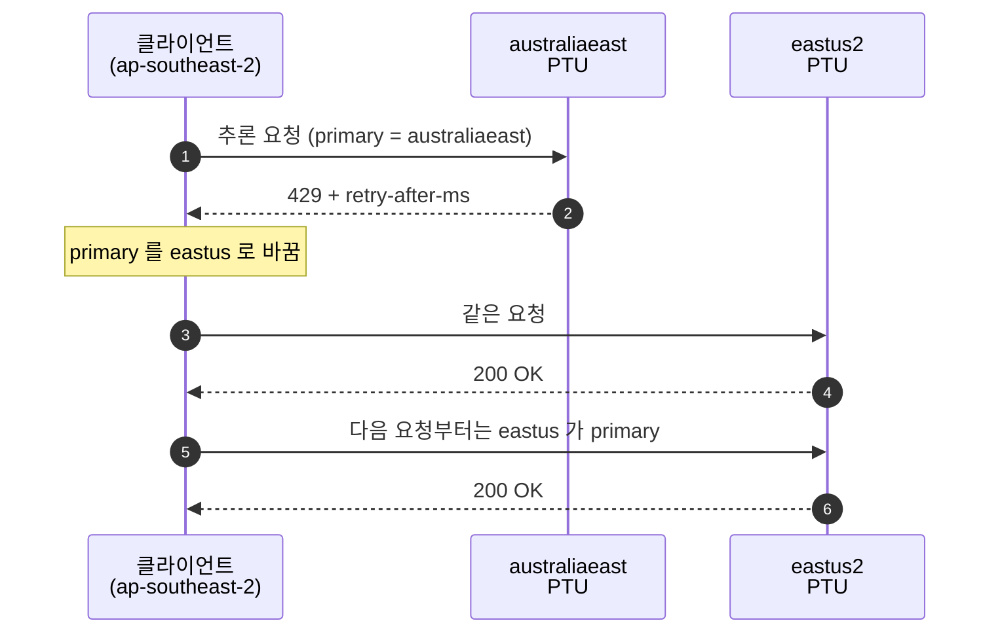
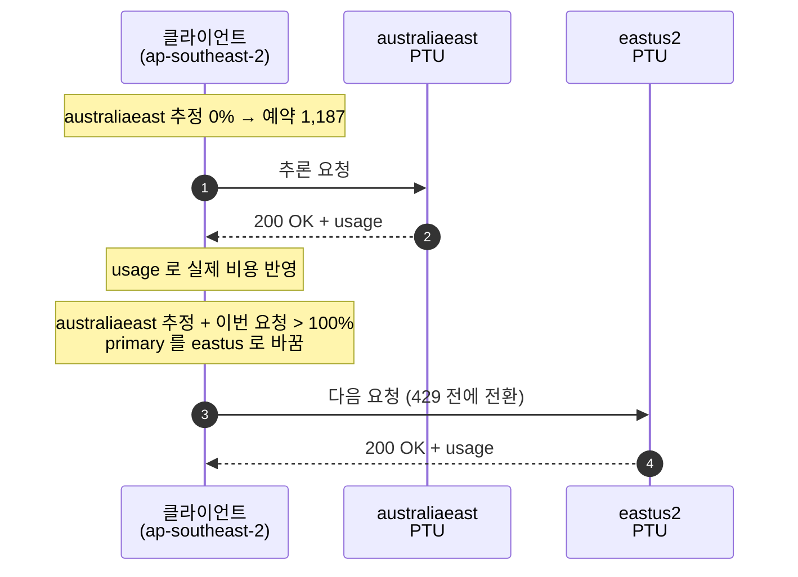

# Multi-region PTU 라우팅 실험

두 라우팅 전략을 실제 PTU 배포로 비교하기 위해 만든 실험 코드다. 부하 패턴 생성, 설정 파일, 두 전략의 공용 실행기가 들어 있어 [루트의 클라이언트 코드](../../README.md#34-multi-region-ptu-라우팅)보다 복잡하다. 실험 결과는 [`experiment-report.html`](experiment-report.html) 에 있고, 여기서 확인한 동작을 루트의 두 파일이 각각 하나씩 구현한다.

| 이 디렉터리 | 루트 |
|---|---|
| `--strategy` 로 두 전략을 한 CLI 에서 고른다 | 전략마다 파일 하나 |
| `regions.json` 과 `routes` 로 클라이언트 리전별 우선순위를 둔다 | `--region` 을 준 순서가 우선순위 |
| `--load-ptu` 로 PTU 포화를 재현하는 묶음 발송 모드가 있다 | `--requests`・`--burst` 만 |

예시 구성은 다음과 같다.

| 구분 | 값 |
|---|---|
| Azure | `eastus2` 100 PTU, `australiaeast` 100 PTU (모델 `gpt-image-2`) |
| 클라이언트 | AWS EC2 — 미국 동부(`us-east-1`/`us-east-2`), 호주 동부(`ap-southeast-2`) |

---

## 1. Azure 인프라 준비

| 구분 | 필요한 것 | 비고 |
|---|---|---|
| Foundry 리소스 | 리전마다 1개 (`eastus2`, `australiaeast`) | Entra ID 인증에는 custom subdomain 이 필요하다 |
| PTU 쿼터 | 구독 × 리전 × 배포 유형마다 따로 신청 | 쿼터가 있어도 용량이 보장되지는 않는다. 배포를 먼저 만들어 확인한다 |
| 모델 배포 | 리전마다 PTU 배포 | 이름을 같게 두면 설정이 단순하다. 다르면 `regions.<name>.deployment` 로 덮어쓴다 |
| RBAC | 두 리소스 모두에 `Cognitive Services OpenAI User` | 리소스 그룹 범위로 한 번에 줘도 된다 |
| 모니터링 | 리소스마다 `Provisioned-managed utilization V2` | 리전별로 포화 여부를 따로 본다 |

### 1.1 알아둘 제약

- **서비스 측 spillover 는 리전을 넘지 못한다.** 배포 속성이나 `x-ms-spillover-deployment` 헤더로 지정하는 대상은 같은 Foundry 리소스 안의 배포다. 리전 간 전환은 클라이언트(이 코드)나 API Management 같은 게이트웨이가 맡아야 한다.
- **PTU 배포에 Traffic spillover 를 설정하면 429 가 클라이언트까지 오지 않는다.** 같은 리전의 Standard 배포가 먼저 받는다. 리전 간 전환을 보려면 PTU 배포의 [Traffic spillover] 를 비워 둔다.
- **Data Zone Provisioned 는 US·EU 만 지원한다.** 호주 데이터를 호주 안에서만 처리해야 한다면 `australiaeast` 는 Regional Provisioned 로 배포하고, 호주 요청이 `eastus2` 로 넘어가도 되는지 먼저 확인한다.
- **Front Door·Traffic Manager 만으로는 429 전환이 안 된다.** 헬스 프로브 기반이라 요청 단위 429 를 보고 경로를 바꾸지 않는다.

### 1.2 AWS EC2 에서 접근

| 항목 | 방법 |
|---|---|
| 인증 | EC2 에서는 Azure Managed Identity 를 쓸 수 없다. Service principal(인증서는 AWS Secrets Manager 에 보관), Workload Identity Federation, Azure Arc 등록 중 하나로 `DefaultAzureCredential` 이 토큰을 받게 한다. API key 는 구독 정책에 따라 막힐 수 있다 |
| 네트워크 | 공용 경로면 Foundry 리소스 방화벽에 EC2 의 Elastic IP 또는 NAT Gateway IP 를 허용한다. 사설 경로면 VPN·Direct Connect 로 Azure VNet 에 연결하고 리전마다 Private Endpoint 를 둔다. 이때 Route 53 Resolver 가 `*.openai.azure.com` 을 Azure DNS Private Resolver 로 넘기게 한다 |
| 지연 | 호주 ↔ 미국 왕복은 약 200ms 다. 수십 초 걸리는 이미지 생성에는 작지만 chat 의 첫 토큰 지연에는 드러난다 |

---

## 2. Strategy

`--strategy` 로 두 방식 중 하나를 고른다. 두 방식 모두 **primary 리전 하나로만 보낸다.** primary 가 막히면 `routes` 의 순서에서 다음 리전이 새 primary 가 되고, 원래 리전이 풀려도 되돌아가지 않는다. 새 primary 가 막히면 또 다음으로 넘어가며 순환한다. 모든 리전이 막혔으면 가장 먼저 풀리는 리전을 새 primary 로 삼아 그때까지 기다린다. `routes` 의 첫 리전이 시작 primary 다(호주 EC2 면 `australiaeast`).

| Strategy | primary 를 바꾸는 시점 | 기준 |
|---|---|---|
| `429-spillover` | primary 가 429 를 **돌려준 뒤** | 응답 헤더 `retry-after-ms` |
| `capacity-aware` | primary 가 429 를 **돌려주기 전** | 응답 body `usage` 로 추정한 사용량 |

**리전을 옮기는 것은 429 뿐이다.** 429 가 아닌 실패로 리전을 버리면 그 리전의 PTU 를 통째로 놀리게 된다. 실제로 한 리전이 동시 요청 17건 중 1건꼴로 404 를 돌려준 적이 있는데, 그 한 건 때문에 리전을 10초씩 제외하니 primary 가 계속 되돌아왔다.

| 응답 | 처리 |
|---|---|
| 429 | primary 를 옮기고, 그 리전은 `retry-after-ms` 동안 쓰지 않는다 |
| 연결 실패·타임아웃, 404, 408, 5xx, body 파싱 실패 | **같은 리전에** 다시 보낸다. 리전을 옮기지도, 제외하지도 않는다. 원인 파악을 위해 응답 본문 앞부분을 로그에 남긴다 |
| 400·401·403 | 요청 자체의 문제라 어느 리전에서도 같으므로 바로 실패로 끝낸다 |

리전 하나가 오래 죽어 있으면 `--max-attempts` 를 다 쓰고 그 요청은 실패한다. 리전 장애까지 자동으로 넘기려면 연속 실패 횟수를 세어 임계치를 넘을 때만 그 리전을 빼는 규칙을 따로 두어야 한다.

### 2.1 `429-spillover`

primary 에 보내다가 429 를 받으면 기다리지 않고 그 요청을 다음 리전으로 다시 보내고, 그 리전을 새 primary 로 삼는다. 429 를 받은 리전은 `retry-after-ms` 동안 쓰지 않는다. 그래서 같은 리전에 429 가 반복되지 않는다.



### 2.2 `capacity-aware`

PTU 응답에는 남은 용량을 알려주는 헤더가 없다. `x-ratelimit-remaining-*` 는 Standard 배포 전용이다([3.1.1](../../README.md#311-응답-헤더-정보) 참고). 그래서 서비스의 [사용률 계산 방식](https://learn.microsoft.com/en-us/azure/foundry/openai/how-to/provisioned-get-started#how-utilization-works)을 클라이언트에서 따라 한다.

1. 리전마다 용량 = `PTU 수 × 모델의 Input TPM per PTU` (분당 정규화 토큰). 100 PTU 의 `gpt-image-2` 는 분당 120,000 이다.
2. 보내기 전에 요청 비용을 추정하고, 넣으면 용량을 넘는 리전은 건너뛴다.
   - `chat.completions`: 서비스와 같이 `prompt 토큰 + max_tokens × 출력 비율` 로 예약한다.
   - `images.generate`: 직전 응답의 실제 비용을 쓴다. 첫 요청은 gpt-image-2 1024x1024 기본 품질 실측값(이미지 출력 196 토큰)으로 추정한다.
3. 응답을 받으면 body 의 `usage` 를 [sizing 공식](https://learn.microsoft.com/en-us/azure/foundry/openai/how-to/provisioned-throughput-sizing)으로 환산해 예약량을 실제 값으로 바꾼다.
4. 사용량은 PTU 수에 비례한 속도로 계속 줄어든다(분당 용량만큼).
5. 그래도 429 를 받으면 그 리전을 가득 찬 것으로 보고 `retry-after-ms` 동안 막은 뒤 primary 를 옮긴다.

| API | usage 필드 | 정규화 토큰 |
|---|---|---|
| `chat.completions` | `prompt_tokens`, `completion_tokens`, `prompt_tokens_details.cached_tokens` | `(prompt − cached) + 출력 비율 × completion` |
| `images.generate` | `input_tokens`, `output_tokens`, `input_tokens_details.image_tokens` | `텍스트 입력 + 이미지 입력 × 1.6 + 이미지 출력 × 3.75 × 1.6` |



> [!IMPORTANT]
> 추정치는 **이 프로세스가 보낸 트래픽만** 반영한다. 미국 EC2 와 호주 EC2 가 같은 PTU 를 함께 쓰면 각자 실제보다 낮게 추정하고, 그 차이는 429 를 받을 때 바로잡힌다. 여러 클라이언트가 추정치를 공유하려면 Redis 같은 공용 저장소나 API Management 가 필요하다. `--headroom 0.8` 처럼 여유를 두면 다른 클라이언트 몫을 어느 정도 흡수한다.

---

## 3. 실행

### 3.1 설정

`regions.example.json` 을 `regions.json` 으로 복사해 엔드포인트를 채운다. `regions.json` 은 `.gitignore` 에 들어 있다.

```json
{
  "model": "gpt-image-2",
  "deployment": "gpt-image-2",
  "regions": {
    "eastus2":       { "endpoint": "https://<eastus2-foundry-subdomain>.openai.azure.com/openai/v1/", "ptu": 100 },
    "australiaeast": { "endpoint": "https://<australiaeast-foundry-subdomain>.openai.azure.com/openai/v1/", "ptu": 100 }
  },
  "routes": {
    "us-east-2":      ["eastus2", "australiaeast"],
    "ap-southeast-2": ["australiaeast", "eastus2"]
  }
}
```

| 키 | 설명 |
|---|---|
| `model` | 모델 이름. PTU 환산값을 고르는 데 쓴다. 지원 목록은 `token_usage.py` 의 `PROFILES` |
| `deployment` | 기본 배포 이름. 리전마다 다르면 `regions.<name>.deployment` 로 덮어쓴다 |
| `regions.<name>.ptu` | 그 리전 배포의 PTU 수 |
| `regions.<name>.resourceId` | (선택) Foundry 리소스의 ARM ID. `--record` 로 Azure Monitor 사용률을 함께 받을 때 필요하다. `az cognitiveservices account show -n <이름> -g <rg> --query id -o tsv` 로 얻는다 |
| `routes.<클라이언트 리전>` | 그 클라이언트가 시도할 Azure 리전 순서 |

### 3.2 인자

| Arguments | Required | Default | Description |
|---|---|---|---|
| `--strategy` | Yes | | `429-spillover` \| `capacity-aware` |
| `--config` | | `experiments/route-strategies/regions.json` | 리전 설정 파일 |
| `--client-region` | | `$AWS_REGION` | `routes` 의 키. EC2 에서는 보통 환경변수로 충분하다 |
| `--auth` | | `entra-id` | `entra-id` \| `entra-id=<스코프>` \| `api-key` |
| `--tenant-id` | | `$AZURE_TENANT_ID` | Entra ID 토큰을 받을 테넌트. `az` 기본 테넌트와 리소스 테넌트가 다르면 지정한다. 지정하지 않으면 `Token tenant ... does not match resource tenant` 400 이 난다 |
| `--api` | | `images.generate` | `images.generate` \| `chat.completions` |
| `--prompt` | | | 프롬프트 |
| `--max-tokens` | | `256` | `chat.completions` 전용. 예약량에 그대로 들어간다 |
| `--requests` | | `1` | 동시성 모드: 보낼 요청 수 |
| `--concurrency` | | `1` | 동시성 모드: 동시 요청 수 |
| `--load-ptu` | | | 묶음 발송 모드: 이 PTU 가 1분에 처리할 만큼의 요청을 `--interval` 마다 나눠 보낸다. `--requests`·`--concurrency` 와 함께 쓸 수 없다 |
| `--interval` | | `5` | 묶음 발송 모드: 묶음 간격(초) |
| `--duration` | | `60` | 묶음 발송 모드: 보내는 기간(초) |
| `--max-workers` | | `256` | 묶음 발송 모드: 동시에 떠 있을 수 있는 요청 상한 |
| `--max-attempts` | | `5` | 요청 하나당 최대 시도 횟수. 리전을 바꿔 보내는 것도 한 번으로 센다 |
| `--headroom` | | `1.0` | `capacity-aware` 전용. 추정 용량의 이 비율까지만 채운다 |
| `--record` | | | 실행 기록을 JSON 으로 저장한다. 시도별 절대 UTC 시각, 추정 사용률 표본, Azure Monitor 메트릭이 한 파일에 들어간다 |
| `--sample-interval` | | `1` | `--record` 전용. 추정 사용률을 찍는 간격(초) |
| `--skip-metrics` | | | `--record` 전용. 실행 뒤 Azure Monitor 조회를 생략한다 |

API key 는 리소스마다 다르므로 명령줄이 아니라 리전별 환경변수 `FOUNDRY_API_KEY_<REGION>` 로 받는다(예: `FOUNDRY_API_KEY_EASTUS2`, `FOUNDRY_API_KEY_AUSTRALIAEAST`).

```bash
# 호주 EC2: 429 를 받으면 eastus2 로 넘긴다
python experiments/route-strategies/foundry-ptu-multi-region.py \
  --strategy 429-spillover \
  --client-region ap-southeast-2 \
  --requests 20 --concurrency 5

# 호주 EC2: 추정 사용량이 80% 를 넘기 전에 eastus2 로 넘긴다
python experiments/route-strategies/foundry-ptu-multi-region.py \
  --strategy capacity-aware \
  --client-region ap-southeast-2 \
  --requests 20 --concurrency 5 --headroom 0.8
```

동시성 모드는 앞 요청이 끝나야 다음 요청을 보내므로, 응답이 느려지면 보내는 양도 줄어든다. 실제 트래픽처럼 응답 속도와 상관없이 일정량을 보내려면 묶음 발송 모드를 쓴다. 요청당 비용은 첫 추정치(이미지는 실측 1,187 정규화 토큰)로 계산한다.

```bash
# 두 리전 합계(200 PTU)가 1분에 처리할 양을 5초마다 나눠 3분 동안 보낸다
python experiments/route-strategies/foundry-ptu-multi-region.py \
  --strategy capacity-aware \
  --client-region ap-southeast-2 \
  --load-ptu 200 --interval 5 --duration 180
```

실행이 끝나면 리전별 처리 건수와 추정 사용률, 총 시도 횟수를 출력한다. 두 strategy 를 같은 부하로 돌려 **총 시도 − 요청 수**(= 429 등으로 다시 보낸 횟수)를 비교하면 차이가 드러난다.

### 3.3 장시간 실행과 기록

3분 실험은 실행 시작 시각을 분 단위로만 남겨, 나중에 Azure Monitor 의 분 단위 값과 맞출 때 정렬을 사후에 추정해야 했다. 표본도 실행·리전당 4개뿐이라 결론이 나지 않았다([`experiment-report.html`](experiment-report.html) 참고). `--record` 는 그 두 가지를 함께 해결한다.

| 남는 것 | 쓰임 |
|---|---|
| `requests[].attempt_log[]` | 시도마다 리전·상태·**보낸 절대 UTC 시각**·받은 시각·예약량. 묶음을 벽시계 위에 다시 만들 수 있다 |
| `levels[]` | `--sample-interval` 마다 찍은 리전별 추정 사용률. 리포트의 버킷 수위 계열 |
| `metrics.<리전>[]` | `AzureOpenAIProvisionedManagedUtilizationV2` 의 분 단위 값. 실행 직후, **배포를 지우기 전에** 받는다 |

```bash
# 두 strategy 를 각각 60분씩. PTU 는 배포 시각부터 과금되므로 연달아 돌린다.
for S in 429-spillover capacity-aware; do
  python experiments/route-strategies/foundry-ptu-multi-region.py \
    --strategy $S \
    --client-region ap-southeast-2 \
    --load-ptu 200 --interval 5 --duration 3600 \
    --record "run-$S.json"
  sleep 90
done
```

메트릭을 함께 받으려면 `regions.json` 의 각 리전에 `resourceId` 가 있어야 하고, 그 리소스에 `Monitoring Reader` 권한이 필요하다. 없으면 조회를 건너뛰고 실행 기록만 남는다.

> [!IMPORTANT]
> PTU 는 배포가 존재한 시간만큼 과금된다. 실행이 끝나면 **반드시 배포를 삭제한다.** 메트릭 조회를 실행 직후에 넣은 이유이기도 하다.

### 3.4 기록으로 리포트 만들기

`--record` 로 남긴 JSON 두 개를 `build_report.py` 에 주면 리포트 HTML 이 나온다. 본문에 숫자를 손으로 옮겨 적지 않으므로, 표와 차트가 어긋날 일이 없다.

```bash
python experiments/route-strategies/build_report.py \
  experiments/route-strategies/run-429-spillover.json \
  experiments/route-strategies/run-capacity-aware.json
```

| 옵션 | 뜻 |
|---|---|
| `--step` | 차트 묶음 간격(초). 60분 실행은 30초가 적당하다 (120칸) |
| `--level-step` | 버킷 수위 계열을 올릴 격자 간격(초) |
| `--phase-step` | 위상 탐색 간격(초). 좁힐수록 느려진다 |
| `--template` / `--out` | 템플릿과 출력 경로 |

생성기는 두 실행의 실측 점을 한꺼번에 놓고 **창 길이 `width` 와 위상 `phase`** 를 격자 탐색으로 맞춘다. `AzureOpenAIProvisionedManagedUtilizationV2` 가 순간값 게이지인지 그 분의 처리량인지는 사실 같은 식의 특수한 경우(`width`=60, `phase`=60)라, 물어야 할 것이 둘 중 무엇이냐가 아니라 `(width, phase)` 가 얼마냐이기 때문이다. 자세한 것은 [`experiment-report-60min.html`](experiment-report-60min.html) 에 있다.

### 3.5 테스트

```bash
pip install pytest
python -m pytest experiments/route-strategies/tests
```

---

## 4. 파일 구성

| 파일 | 역할 |
|---|---|
| `experiment-report.html` | 실제 PTU 배포로 두 strategy 를 비교한 실험 리포트 (2026-09-17, 브라우저로 연다) |
| `regions.example.json` | 설정 파일 예시. `regions.json` 으로 복사해 엔드포인트를 채운다 |
| `foundry-ptu-multi-region.py` | CLI. 설정을 읽고 요청을 동시에 보낸 뒤 요약한다 |
| `routing.py` 의 `Primary` | 지금 요청을 받는 리전과 전환 규칙 |
| `load_pattern.py` | 묶음 발송 모드의 요청 일정과 실행 |
| `routing.py` | 두 strategy 의 리전 선택과 요청 하나의 재시도·전환 루프 |
| `capacity_tracker.py` | 리전별 추정 사용량(leaky bucket)과 차단 시간 |
| `token_usage.py` | 모델별 PTU 환산값, `usage` → 정규화 토큰, 요청 비용 추정 |
| `region_config.py` | `regions.json` 읽기·검증 |
| `foundry_client.py` | 리전별 openai 클라이언트와 인증, 호출 결과 변환 |
| `run_record.py` | 실행 기록 JSON 조립·저장 |
| `sampler.py` | 실행 중 리전별 추정 사용률을 주기적으로 기록 |
| `metrics.py` | Azure Monitor 사용률 메트릭 조회 (`az` CLI) |
| `experiment-report-60min.html` | 두 strategy 를 각각 60분 돌린 2차 실험 리포트 (2026-09-18, `build_report.py` 가 만든다) |
| `build_report.py` | 실행 기록 JSON → 리포트 HTML. 자리표시자를 하나라도 못 채우면 실패한다 |
| `report_template.html` | 리포트 본문과 차트 엔진. 숫자는 `{{자리표시자}}` 로 비워 둔다 |
| `report_data.py` | 실행 기록을 구간·수위·전환·실측 점으로 되돌린다 |
| `report_figures.py` | 차트가 읽는 `DATA`·`METRIC` 과 본문 머릿수 조립 |
| `metric_fit.py` | 실측값이 재는 창 길이와 위상을 격자 탐색으로 맞춘다 |
